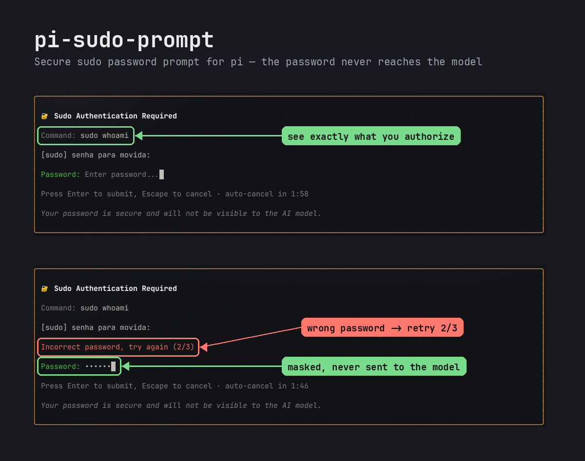

# pi-sudo-prompt

Prompt seguro de senha do `sudo` para o [Pi Coding Agent](https://pi.dev), no estilo do *Sudo password prompting* do Cursor.

Quando o agente (ou você, via `!`/`!!`) roda um comando com `sudo`, o pi abre um modal **Sudo Authentication Required** com campo mascarado. A senha vai direto para o `sudo` e **nunca passa pelo modelo**: não aparece no output do tool, na sessão nem no histórico.



<details><summary>Versão texto</summary>

```
╭────────────────────────────────────────────────────────────────────╮
│ 🔐 Sudo Authentication Required                                    │
│                                                                    │
│ Command: sudo apt update                                           │
│                                                                    │
│ [sudo] senha para movida:                                          │
│                                                                    │
│ Password: ••••••••                                                 │
│                                                                    │
│ Press Enter to submit, Escape to cancel · auto-cancel in 1:54      │
│                                                                    │
│ Your password is secure and will not be visible to the AI model.   │
╰────────────────────────────────────────────────────────────────────╯
```

</details>

## Instalação

```bash
pi install npm:@igor-guari/pi-sudo-prompt
# ou
pi install git:github.com/IgorGuariroba/pi-sudo-prompt@v0.1.3
```

Requer Linux e o pi no modo interativo (TUI).

## Como funciona

```
agente: sudo whoami
        │
        ▼
   sudo -A  ──exec──►  pi-askpass  (SUDO_ASKPASS)
        ▲                   │  valida: pai é sudo/doas com euid 0 e stdout é o pipe do sudo
        │ stdout (senha)    │  Unix socket privado + HMAC
        │                   ▼
        │            extensão (sessão do pi)
        │                   │  revalida o processo solicitante
        │                   ▼
        │            modal "Sudo Authentication Required"
```

1. Na sessão, a extensão cria um diretório privado (`$XDG_RUNTIME_DIR/pi-sudo-prompt-*`, modo `0700`) com o socket e o launcher `pi-askpass`.
2. Cada comando do bash tool e dos comandos `!`/`!!` recebe `SUDO_ASKPASS`, `PI_ASKPASS_SOCKET`, `PI_ASKPASS_SECRET` e uma função `sudo()` que acrescenta `-A`. A função não acrescenta `-A` quando o comando já usa `-S`/`--stdin` ou `-A`.
3. O `sudo` executa o launcher, que limpa o ambiente (`env -i`) e inicia o auxiliar com o prompt (`[sudo] senha para movida:`). O auxiliar confere se o processo pai é `sudo`/`doas` rodando como root e se o stdout é o pipe privado do sudo (FIFO com dono root, modo `600`). Depois envia um `password_request` assinado.
4. A extensão revalida tudo no `/proc` antes de abrir o modal: pai é sudo privilegiado; argv exato `node askpass.mjs <prompt>`; interpretador esperado; ambiente exatamente o do launcher (sem `NODE_OPTIONS`, `LD_PRELOAD` etc.); stdout é o pipe do sudo.
5. **Enter** responde com `password_response`; **Escape**, o timeout de 120 s ou o fim do `sudo` (por abort do tool, por exemplo) respondem com `password_denied`.
6. O auxiliar imprime a senha no pipe do `sudo` e termina. Se a senha estiver errada, o `sudo` pede de novo, e o modal mostra `Incorrect password, try again (2/3)`.

**Cancelar conta como tentativa falha:** para o PAM, um askpass cancelado (Escape ou timeout) é uma falha de autenticação, exatamente como no `sudo` sem a extensão. Com o `pam_faillock` padrão, 3 falhas em 15 minutos bloqueiam o `sudo` por 10 minutos. Para liberar antes: `faillock --user "$USER" --reset`.

**Cache de credenciais:** sem TTY, o `sudo` (com o padrão `timestamp_type=tty`) guarda o cache por processo pai, e cada comando do agente roda num shell novo. Por isso **cada comando com `sudo` abre o modal de novo**. Agrupe as etapas num único comando (`sudo apt update && sudo apt upgrade -y`) para autenticar uma vez só. Dentro do mesmo comando, o cache vale normalmente.

## Limites

- **Só Linux.** A validação usa `/proc`. O suporte a macOS fica para depois.
- **Só no modo interativo.** Em `pi -p`, `--mode json` e RPC nada é injetado, e o `sudo` se comporta como sem a extensão.
- **Substitui o tool `bash`.** A extensão registra seu próprio `bash` (mesma implementação e renderização do built-in, com `shellCommandPrefix`/`shellPath` das settings). Outra extensão que também substitua o `bash` vai conflitar.
- A função `sudo()` só existe no shell do comando. Scripts filhos e `xargs sudo` ainda usam o modal (sem TTY, o `SUDO_ASKPASS` basta), mas não recebem o `-A` forçado.
## Modelo de ameaça

A senha nunca entra no contexto do modelo nem nos registros da sessão. Além disso, a extensão resiste a um agente que tente desviar a senha usando o próprio mecanismo de askpass. Todos estes casos são recusados antes de o modal abrir e estão cobertos por `test/exfiltration.test.mjs` com o sudo real:

- `SUDO_ASKPASS` apontando para um wrapper que roda o auxiliar com stdout redirecionado (arquivo, fifo com leitor em background, pipe próprio). O pipe legítimo é criado pelo sudo como root, e um processo do seu usuário não consegue criar nem reabrir um pipe assim.
- Injeção de código no auxiliar via `NODE_OPTIONS`, `--import` no argv ou wrapper que contorna o launcher.

**O que não é coberto:** um agente que **altere arquivos que pertencem a você** (`askpass.mjs`, `protocol.mjs`, a extensão em `~/.pi/agent/...`, o binário `node` do nvm). Qualquer código que rode como o seu usuário pode ser trocado por outro processo do seu usuário. Isso só se resolve com um auxiliar de dono root, previsto como modo blindado opcional numa versão futura. Até lá: o modal mostra o comando que será autorizado, confira antes de digitar, e desconfie de transcripts em que o agente edita arquivos da extensão ou do node.

## Segredos que não são do sudo (`pi-secret-run`)

Para um **segredo durável** de outro consumidor (senha mestra do `keepassxc-cli`, chave de API, token de login), o agente roda:

```bash
pi-secret-run --label "senha mestra do KeePassXC" -- keepassxc-cli show -q -t db.kdbx npm
```

O pi abre o modal **Pedido de segredo**, com título diferente do modal do sudo. O modal mostra o argv real lido pelo broker, a descrição do agente marcada como "não verificada" e o aviso vermelho "este comando pode mostrar ao agente o que você digitar". O segredo digitado vai para o stdin do comando. O agente vê só a saída do comando (um OTP, por exemplo). Não há cache: cada chamada abre o modal. Decisões em [`docs/adr/0002-broker-root-para-segredos-duraveis.md`](docs/adr/0002-broker-root-para-segredos-duraveis.md).

**Instalação do broker (uma vez, como root).** No TUI do pi, o usuário pode executar `/sudo-prompt install-broker`: a senha vem do modal existente do sudo, sem passar pelo agente. É um comando de usuário, não uma tool; fora do TUI ele recusa. Para instalar manualmente, leia o script antes de rodar:

```bash
sudo sh ~/.pi/agent/<caminho do pacote>/broker/install.sh   # a mensagem de recusa do pi-secret-run mostra o caminho exato
```

As duas opções usam o mesmo instalador: broker em `/usr/local/libexec/pi-sudo-prompt/pi-secret-broker` (Python, só biblioteca padrão, dono root), regra `/etc/sudoers.d/pi-sudo-prompt` (`NOPASSWD` só para o broker), validada com `visudo -c`, e allowlist inicial em `/etc/pi-sudo-prompt/allowlist` (root, vazia com exemplos comentados). Uma allowlist existente nunca é sobrescrita. Rode de novo depois de atualizar o pacote: o broker é atualizado e a extensão recusa versões divergentes do protocolo.

**Como funciona:** `pi-secret-run` chama o broker por `sudo -n`. O broker, como root, pede o segredo à extensão pelo socket da sessão e prova que é ele com um arquivo em `/run/pi-sudo-prompt` que só root pode criar. A extensão confere euid 0, o argv exato `/usr/bin/python3 -I <broker> …` e os arquivos com dono root. Depois o broker cria um pipe como root (`0600`), executa o comando com o seu uid/gid (nunca root) e escreve o segredo no stdin dele. O segredo nunca vai por variável de ambiente.

**Recusas** (código de saída diferente de zero, com o motivo): broker ausente (a mensagem mostra como instalar), versão divergente, fora do TUI, sistema que não é Linux, modal cancelado ou expirado. Não há modo sem root.

**Limites da garantia:**
- O aviso vermelho aparece sempre nesta versão. Se você aprovar um comando que ecoa o que recebe (`cat`, por exemplo), o segredo vai para o agente por escolha sua. Leia o comando no modal.
- O comando roda com o seu uid, então a memória dele fica ao alcance do ptrace: com `kernel.yama.ptrace_scope=0`, por qualquer processo seu; com `ptrace_scope=1`, por um processo seu que seja ancestral dele (um programa que lança o `pi-secret-run` e depois depura o comando). A garantia contra reabrir o pipe e ler o `environ` não cobre esse caso.

## Desenvolvimento

```bash
npm test                      # protocolo, auxiliar, função sudo(), ataques de exfiltração (sudo real, sem autenticar)
                              # e pi-secret-run → broker real (pulados se o broker não estiver instalado)
pi install ./                 # carrega a cópia local
```

Decisões de arquitetura em [`docs/adr/`](docs/adr/).

## Licença

MIT
